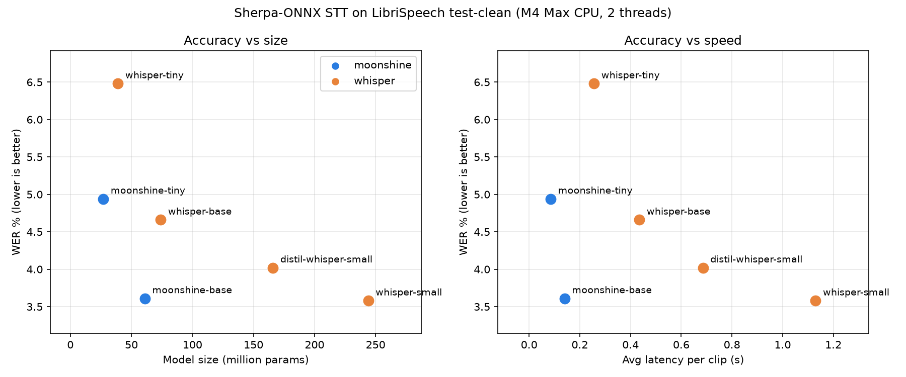

# Sherpa-ONNX STT

One interface for every speech-to-text model, so we can swap models without rewriting code, plus a benchmark that compares them on the same clips.

| File | What it does |
|---|---|
| `stt.py` | Model registry + `load(name)` / `transcribe(rec, samples)`. Also a CLI for mic or `.wav` (mic/VAD loop from Adwaiy's `moonshine_demo1.py`) |
| `benchmark.py` | WER, speed and size for each model on the same clips, writes `results.csv` |
| `plot.py` | Charts `results.csv` into `results.png` |

```python
from stt import load, transcribe
rec = load("moonshine-base")              # or whisper-small, distil-whisper-small, ...
text, seconds = transcribe(rec, samples)  # 16 kHz mono float32
```

## Setup

From `behavior_tree/nlp`:
```bash
python3 -m venv venv && source venv/bin/activate
pip install -r model_experiments/sherpa/requirements.txt
```
Linux/Jetson only: `sudo apt install libportaudio2`

Models (~1.6 GB unpacked) and dataset go in `models/` and `data/` (gitignored). From this folder:
```bash
cd models
for m in moonshine-tiny-en-int8 moonshine-base-en-int8 whisper-tiny.en whisper-base.en whisper-distil-small.en whisper-small.en; do
  curl -L https://github.com/k2-fsa/sherpa-onnx/releases/download/asr-models/sherpa-onnx-$m.tar.bz2 | tar xj
done
curl -LO https://github.com/k2-fsa/sherpa-onnx/releases/download/asr-models/silero_vad.onnx
cd ../data && curl -L https://www.openslr.org/resources/12/test-clean.tar.gz | tar xz   # LibriSpeech, 346 MB
```

Add a model: unpack its sherpa-onnx folder into `models/`, add one line to `MODELS` in `stt.py` (if it's a new family like Parakeet, add a branch in `load()` using the matching `OfflineRecognizer.from_*`).

## Usage

```bash
python stt.py --list                               # models + whether downloaded
python stt.py --model whisper-base                 # live mic
python stt.py --model moonshine-tiny --wav clip.wav
python benchmark.py                                # all models, 200 LibriSpeech clips
python benchmark.py --models moonshine-base whisper-small -n 50
python benchmark.py --data walle.tsv               # your own set: path<TAB>transcript per line
python benchmark.py --selftest
python plot.py                                     # results.csv -> results.png
```

## Results: accuracy vs model size

LibriSpeech test-clean, 199 clips (24.6 min, spread across all 40 speakers; one clip over 28 s dropped because Whisper caps input at 30 s). int8, 2 threads, MacBook M4 Max CPU. **Latency here is not Jetson latency.** Rerun on the Orin Nano.



| model | params | disk | WER ↓ | RTF ↓ | avg latency / clip (7.4 s avg) |
|---|---|---|---|---|---|
| moonshine-tiny | 27M | 124 MB | 4.94% | 0.012 | 0.09 s |
| whisper-tiny | 39M | 104 MB | 6.48% | 0.035 | 0.26 s |
| **moonshine-base** | 61M | 287 MB | **3.61%** | 0.019 | 0.14 s |
| whisper-base | 74M | 161 MB | 4.66% | 0.059 | 0.44 s |
| distil-whisper-small | 166M | 299 MB | 4.02% | 0.093 | 0.69 s |
| whisper-small | 244M | 376 MB | **3.58%** | 0.153 | 1.13 s |

- WER = word errors / reference words (lower is better). RTF = compute time / audio length (0.1 = 10x faster than real time).
- **moonshine-base matches whisper-small's accuracy at 1/4 the params and ~8x the speed.** At equal size, Moonshine beats Whisper (tiny: 4.9 vs 6.5%, base: 3.6 vs 4.7%).
- Disk is what `load()` actually reads. Moonshine's is bigger than its param count suggests because `preprocess.onnx` is not quantized.
- Transcripts get lowercased, punctuation is stripped, and Mr/Mrs/etc. are expanded. Numbers aren't normalized ("1837" vs "eighteen thirty seven" counts as wrong), which adds a little to every model's WER.

## Caveats / next steps

- **LibriSpeech is clean audiobook speech, not robot commands.** Rankings may change on short, noisy Wall-E commands, and on names like "Wall-E" ("wally"). Next: build a Wall-E command set (e.g. our 50–100 test requests, recorded or TTS'd, mixed with background noise at a few SNRs) and run it with `--data walle.tsv`.
- Hint words aren't supported for Whisper or Moonshine through sherpa (only transducer models). Moonshine's official library supports keyterms on its streaming models (see Adwaiy's `moonshine_demo2.py`).
- Parakeet isn't benchmarked yet. sherpa-onnx has an int8 NeMo build, so it's one more `load()` branch without the NeMo install pain.
